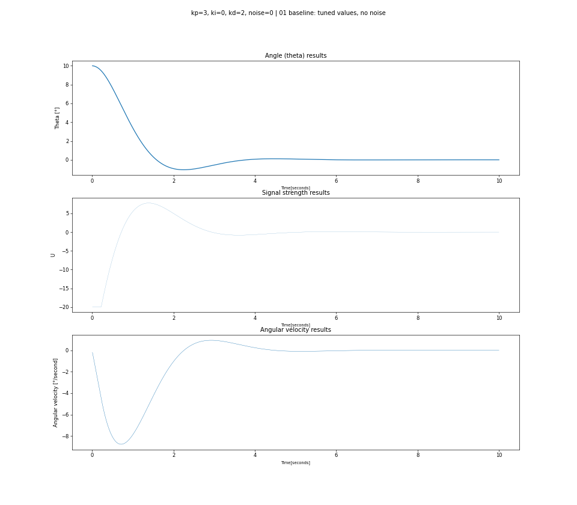

# Zadanie ACS: Pętla sterowania PID

Stabilizacja rakiety w pionie (θ = 0°) za pomocą regulatora PID. Rakieta startuje z przechyleniem 10°, a regulator ma ją wyprostować i utrzymać w pionie. Program `ACS_zad_1.py` symuluje 10 s ruchu rakiety w jednej płaszczyźnie.

## Dobór nastaw i wynik główny

Wybrane nastawy: **Kp = 3, Ki = 0, Kd = 2**

Nastawy dobrałem metodą prób, porównując przebiegi dla różnych wartości Kp, Ki i Kd. Ki wyłączyłem, ponieważ w tym modelu I powodowało wyłącznie większe rozjeżdżanie się wartości. Mniej więcej po 3,5 sekundy wartość θ zawierała się w ± 0.2°

## Odpowiedzi na pytania dodatkowe

Odpowiedzi zawierają sie w symulacjach preprowadzonych w pliku.

### Co się stanie, jeśli zwiększysz Kp?

Kp określa, jak mocny sygnał sterujący wytwarza regulator przy danym odchyleniu od pionu. Po zwiększeniu Kp rakieta szybciej wraca do pionu, ale mocniej się przeregulowuje i bardziej oscyluje. Sygnał częściej uderza też w ograniczenie ±20. Dodatkowo duże Kp mocniej przenosi małe szarpnięcia odczytu (szum) na sygnał sterujący, co pogarsza stabilność w pobliżu θ = 0.

### Dlaczego Ki może powodować przeregulowanie?

Człon I to suma odchyleń z przeszłości. Zaczynając od sporego wychylenia suma poszczególnych położeń może przy dużym Ki  generować zupełnie oderwaną od chwilowej sytuacji presję na to, aby sygnał sterował rakietą w stronę, w której był jakiś czas temu.

### Jaką rolę pełni Kd?

Człon D liczy różnicę między obecnym a poprzednim uchybem, czyli to, jak szybko w danej chwili zmienia się kąt rakiety. Wielkość Kd oznacza to, jak mocno Bez członu D (Kd = 0) oscylacje w tym modelu w ogóle nie gasną, a zbyt duże Kd spowalnia powrót do pionu.

### Jak można dodać szum do pomiaru kąta, by sprawdzić odporność regulatora?

Szum dodałem jako błąd przyrządu pomiarowego: do prawdziwego kąta dodaję losową wartość z przedziału ±noise, a pętla liczy  na tym odczycie. Fizyka nadal działa na prawdziwym kącie, który pokazuje, gdzie rakieta naprawdę jest. Odporność sprawdzam, uruchamiając symulację dla kilku poziomów szumu i porównując, czy θ nadal się ustala oraz jak duże są wahania kąta po ustaleniu.
